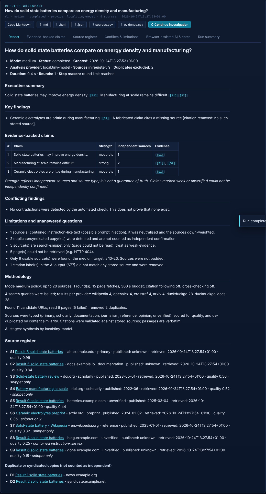
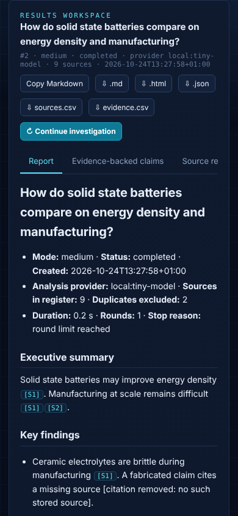

# ATLAS - Local-First Research Facility

ATLAS investigates a question the way a careful analyst would. It searches several independent sources, reads the pages, scores and de-duplicates them, lets an AI model write a synthesis (a local model, an optional online API, or an AI website you are already signed in to), then **checks every citation against the sources it actually stored** and produces a report you can trace claim by claim.

- Runs on your machine. Python + FastAPI + SQLite. **No Docker, no GPU, no telemetry, no model downloads.**
- The dashboard listens on `127.0.0.1` only.
- Built for modest Debian laptops (4-8 GB RAM): bounded concurrency, size limits, caching, memory-aware execution.



---

## Contents

1. [Setup, step by step](#1-setup-step-by-step)
2. [Your first investigation](#2-your-first-investigation)
3. [The dashboard](#3-the-dashboard)
4. [Research modes](#4-research-modes)
5. [AI workflows and how to set each one up](#5-ai-workflows-and-how-to-set-each-one-up)
6. [Search providers](#6-search-providers)
7. [Evidence, citations and claim strength](#7-evidence-citations-and-claim-strength)
8. [Reports and export](#8-reports-and-export)
9. [Data, backup and restore](#9-data-backup-and-restore)
10. [Onion / Tor module (optional)](#10-onion--tor-module-optional)
11. [Configuration reference](#11-configuration-reference)
12. [HTTP API reference](#12-http-api-reference)
13. [Security model](#13-security-model)
14. [How it works (architecture)](#14-how-it-works-architecture)
15. [Development and testing](#15-development-and-testing)
16. [Troubleshooting](#16-troubleshooting)
17. [Status: what is tested and what is not](#17-status-what-is-tested-and-what-is-not)

---

## 1. Setup, step by step

Tested on Debian-style Linux. `run.sh` never uses `sudo`, never changes system services and never overwrites your configuration.

### Requirements

| Needed | Why | Notes |
|---|---|---|
| Linux shell (Debian recommended) | runs the launcher | macOS also works; Windows: use WSL |
| **uv** | creates the virtualenv and installs dependencies from `uv.lock` | step 1 below, no sudo needed |
| Python 3.10+ | runtime | uv uses your Python, or fetches one if none is suitable |
| Internet | web search and page reading | the app itself runs offline; research needs the network |
| *Optional:* a local model server | local AI synthesis | Ollama or llama.cpp, see [section 5](#5-ai-workflows-and-how-to-set-each-one-up) |
| *Optional:* Tor | onion module only | see [section 10](#10-onion--tor-module-optional) |

### Steps

**Step 1 - Install uv (once).**

```bash
curl -LsSf https://astral.sh/uv/install.sh | sh
```

Open a new terminal (or run `source ~/.local/bin/env`) and check it: `uv --version`.
Alternatives: `pipx install uv` or `pip install --user uv`.

**Step 2 - Unpack the project.**

```bash
unzip atlas-research-facility.zip
cd atlas
chmod +x run.sh stop.sh
```

**Step 3 - (Optional) create your configuration file.**

```bash
cp .env.example .env
nano .env        # change the port, local model URL, or add API keys
```

`.env` is git-ignored. Variables you already exported in your shell take priority over `.env`.

**Step 4 - Start ATLAS.**

```bash
./run.sh            # foreground; press Ctrl+C to stop
# or
./run.sh --bg       # background; logs go to atlas.log
```

The first start creates `./.venv` from `uv.lock` (takes a few seconds) and prints the address:

```
ATLAS dashboard:  http://127.0.0.1:8765
```

**Step 5 - Open the dashboard.** Go to <http://127.0.0.1:8765> in your browser.

**Step 6 - Stop ATLAS** when you are done.

```bash
./stop.sh           # stops a --bg instance (or any ./run.sh instance)
```

### Launcher options

| Command | What it does |
|---|---|
| `./run.sh` | start in the foreground |
| `./run.sh --bg` | start in the background, pid in `atlas.pid`, log in `atlas.log` |
| `./run.sh --onion` | also install the optional Tor/SOCKS dependency (`onion` extra) |
| `ATLAS_PORT=8800 ./run.sh` | use another port |
| `./stop.sh` | stop the running instance |

Running it twice is safe: if ATLAS is already running, `run.sh` says so and exits.

### Verify the install (optional, 15 seconds)

```bash
uv sync --group dev          # adds the test tools
uv run pytest                # expect: 145 passed
```

---

## 2. Your first investigation

1. Open the dashboard and stay on **Research desk**.
2. Pick a mode. Start with **Light** (fastest) or **Medium** (balanced).
3. Type a question, for example: *"How do solid-state batteries compare with lithium-ion on energy density and manufacturability?"*
4. Leave **AI workflow** on **Hybrid**. If you have no local model, ATLAS will give you a prompt for browser-assisted analysis instead.
5. Click **Start investigation**. Watch the stage, source counts and event log. **Cancel** works at any time and keeps partial results.
6. When it finishes, read the **Report**, then check **Evidence-backed claims** and **Source register**.
7. Export from the buttons above the tabs.

If search fails (no internet, rate limiting), the report says exactly which provider failed and why. ATLAS never pretends it found sources.

---

## 3. The dashboard

### Research desk

| Control | What it does |
|---|---|
| Mode cards | choose Light / Medium / High / Max (each card shows its real budget) |
| Research question | 5-2000 characters |
| AI workflow | Hybrid, Local only, Browser-assisted, or Online API (see section 5) |
| Project | groups related investigations in the library |
| **Sensitive research** | never sends this run's documents to an online AI provider |
| Filters and budget | only these domains, exclude domains, published from/until, lower the max sources or time budget for this run |
| Start / Cancel | start a run; cancel keeps what was gathered |
| Progress panel | current stage, provider/model, sources in register, candidates found, pages read, queries, duration, live event log |

### Results workspace (tabs)

| Tab | Contents |
|---|---|
| **Report** | executive summary, findings, claims table, limitations, methodology, source register. `[S#]` badges are clickable and jump to the source |
| **Evidence-backed claims** | each cited claim with strength, independent-source count, verbatim supporting quotes and uncertainty notes |
| **Source register** | every source: type, domain, publication date, retrieval time, quality score, clickable link; duplicates listed separately |
| **Conflicts & limitations** | possible contradictions, plus everything that limited the run (failed searches, snippet-only sources, injection flags, budget stops) |
| **Browser-assisted AI & notes** | copy/download the prompt, paste the AI's answer back, add research notes |
| **Run summary** | counts, stop reason, methodology, **stage timeline showing which provider handled each stage**, provider problems |

Buttons: **Copy Markdown**, export `.md` `.html` `.json` `sources.csv` `evidence.csv`, and **Continue investigation**.

### Research library

Search past investigations (full text), filter by mode, status, date range, project and channel (web / onion). Open a saved report, **continue** an investigation (stored sources are carried over and new evidence is added), **compare** two runs (shared and unique sources and claims), and **delete** (always asks for confirmation). A second box searches the text of every stored source.

### Settings

Local model URL and model picker (**Detect models**), default AI workflow, online-provider permission, search provider switches, SearXNG URL, per-mode resource limits, fetch limits and robots.txt switch, backup and restore, and the onion module controls. Every control saves to `data/settings.json` and takes effect on the next run.



The layout is responsive; the screenshot above is a 390 px phone width.

---

## 4. Research modes

Modes are **policies**, not labels. Defaults (defined in `atlas/config.py`):

| | Light | Medium | High | Max |
|---|---|---|---|---|
| Source target / cap | 3-5 / 5 | 10-20 / 20 | 30-50 / 50 | 50-100 / 100 |
| Search rounds | 1 | 1 | 2 | 3 |
| Queries per round | 1 | 4 | 8 | 12 |
| Page fetches | 4 | 15 | 40 | 80 |
| Search categories | web | web, docs, scholar | web, docs, scholar, news | web, docs, scholar, news |
| Sub-question decomposition | no | no | yes | yes |
| Follows citations / references | no | no | yes | yes |
| Cross-checks weakly supported claims | no | no | no | yes |
| Time budget | 90 s | 5 min | 15 min | 30 min |
| Retries per provider call | 1 | 2 | 2 | 3 |
| Concurrent requests | 2 | 3 | 4 | 4 |
| Report style | concise | brief | detailed | comprehensive |

How a run proceeds: **check providers -> plan queries (and sub-questions for High/Max) -> search -> follow references (High/Max) -> read pages -> score, classify, de-duplicate -> save evidence -> synthesise -> (Max) cross-check -> verify citations -> assemble report.**

Rules that apply to every mode:

- Source counts are **targets, not guarantees**. ATLAS never pads the register to reach a number; shortfalls are reported in the limitations.
- Loops are bounded. A run stops on the first of: target source count reached, time budget (gathering uses 80%; the rest is for synthesis), diminishing returns (a round adds nothing new), round limit, low free memory, or cancellation. The stop reason is recorded.
- When free RAM drops below about 200 MB, ATLAS drops to single-threaded fetching and stops gathering early. If a local model times out or runs out of memory, it retries once with half the context.
- A per-run budget (Filters and budget) can only **tighten** the mode's limits. Settings can adjust the limits per mode, always within hard ceilings (150 sources, 1 hour, 150 page fetches, 8 concurrent requests, 5 rounds).

---

## 5. AI workflows and how to set each one up

You choose the workflow explicitly on every run. The default is **Hybrid**.

| Workflow | Behaviour |
|---|---|
| **Local model only** | uses your local server; fails clearly if it is not available |
| **Hybrid** (default) | local model if available, otherwise browser-assisted. It **never** silently switches to a paid provider |
| **Browser-assisted** | no AI call; ATLAS prepares a prompt for you |
| **Online API** | OpenAI-compatible endpoint; needs the three conditions in 5.4 |

If no model processes a run, the report contains **extractive findings**: verbatim passages from stored sources, each with its citation. It is plain but never fabricated.

### 5.1 Local model (recommended)

ATLAS talks to any server that exposes the OpenAI-compatible `/v1/chat/completions` and `/v1/models` endpoints. It reuses what you already run; it never downloads a model.

**Option A - Ollama**

```bash
# install and start Ollama yourself (see ollama.com), then pull a small model you choose:
ollama pull <model-name>
```

In ATLAS: **Settings -> Base URL** `http://127.0.0.1:11434/v1` -> **Detect models** -> pick one -> **Save settings**.

**Option B - llama.cpp server**

```bash
llama-server -m /path/to/model.gguf --port 8080
```

ATLAS's default base URL is `http://127.0.0.1:8080/v1`, so no change is needed.

**Option C - set it by environment**

```bash
# in .env
ATLAS_LOCAL_BASE_URL=http://127.0.0.1:11434/v1
ATLAS_LOCAL_MODEL=your-model-name        # optional; empty = first available
```

Settings saved in the dashboard take priority over these variables.

Notes for 4-8 GB machines: use a small quantised model, prefer **Light** or **Medium**, and lower `llm_context_chars` for a mode in Settings if the model struggles. Errors are explicit: *no server answering*, *configured model not installed (lists installed ones)*, *timed out*, *server error (may be out of memory)*.

### 5.2 Browser-assisted AI (no API key)

Use the AI websites you already pay for or use free, without any API access.

1. Run an investigation with workflow **Browser-assisted** (or **Hybrid** with no local model).
2. Open the **Browser-assisted AI & notes** tab. Click **Copy prompt** (or **Download prompt**).
3. Open your AI website, sign in normally, paste the prompt and submit it.
4. Copy the AI's answer.
5. Back in ATLAS, paste it into the box, optionally name the site, and click **Attach response to investigation**.
6. ATLAS validates every `[S#]` citation against the stored sources, **removes invented ones and tells you**, rebuilds the claims table and shows the merged report.

What ATLAS does **not** do: read or store your cookies, passwords or tokens; automate any website; or claim that a consumer subscription gives API access. The security rules travel inside the prompt itself, because a website chat has no system prompt. Do not paste prompts from sensitive research into services you do not trust.

### 5.3 Notes

Add research notes in the same tab. Notes are *trusted* context included in later analyses of that run.

### 5.4 Online API (optional)

Nothing is sent to an online provider unless **all three** are true:

1. `OPENAI_API_KEY` is set in the environment (or `.env`). Keys are never stored, logged or displayed; only a masked hint like `••••••ab` appears.
2. **Settings -> Allow external AI providers** is switched on (off by default).
3. The run is **not** marked Sensitive.

Use **Settings** for the base URL and model name, so other OpenAI-compatible services work too. API billing is separate from chat subscriptions.

---

## 6. Search providers

All are interchangeable adapters; switch them in **Settings -> Search providers**. ATLAS never depends on a single one.

| Provider | Category | Key needed | Notes |
|---|---|---|---|
| DuckDuckGo (HTML) | web | no | general search; may throttle you; ATLAS reports it and does not bypass bot checks |
| DuckDuckGo (docs-biased) | docs | no | same engine, query biased to documentation/specs/RFCs; follows the DuckDuckGo switch |
| Wikipedia | web | no | reference material |
| OpenAlex | scholar | no | scholarly metadata, abstracts, **reference lists used for citation following** |
| Crossref | scholar | no | scholarly metadata |
| arXiv | scholar | no | preprints |
| GDELT | news | no | news and current events |
| SearXNG | web | no | your own instance; set the URL in Settings; off by default |
| Brave Search API | web | `BRAVE_API_KEY` | off by default |

Also supported: query expansion (model-generated when a model is available, otherwise built-in heuristics), URL de-duplication (tracking parameters, `www.`, fragments), and domain and date filters.

**Page reading:** only public pages; `robots.txt` respected; no CAPTCHA, paywall or access-control bypass (a blocked page is reported as such); redirect, size, timeout and concurrency limits; HTML and PDF text extraction (scripts are never executed); results cached in SQLite for 72 hours.

---

## 7. Evidence, citations and claim strength

**Per source ATLAS stores:** title, canonical URL, domain, retrieval time, publication date (when the page or API provides it), source type, a bounded text copy, verbatim relevant passages, and every run that used it.

**Source types:** `primary` (government, standards, institutions), `scholarly`, `preprint`, `documentation`, `journalism`, `reference`, `opinion`, `unverified`. A quality score combines type, date availability, text length, HTTPS and relevance; search-snippet-only sources and sources containing prompt-injection-like text are down-weighted.

**Independence.** Near-identical texts (and same-titled copies) are grouped. Copies are listed as `D1, D2...` in the register and are **never counted as independent confirmation**.

**Claims** are the cited sentences of the report. For each claim ATLAS stores its supporting sources with a **verbatim quote from stored text**, the number of independent sources, a strength label, and an uncertainty explanation.

| Strength | Meaning |
|---|---|
| strong | at least 2 independent full-text sources, including a primary / scholarly / documentation source or a quality source |
| moderate | 2 independent sources, or one high-quality primary / scholarly / documentation source |
| weak | one lower-quality source |
| unverified | no stored source |

Strength is **not a guarantee of truth**. Possible contradictions are found by a **lexical heuristic** (similar wording with opposite negation) and are labelled "verify manually".

**Citation integrity.** Every `[S#]` must map to a stored source; others are removed and counted in the limitations. If an AI answer contains no valid citation at all, the report marks its statements **UNVERIFIED** and appends extractive findings.

---

## 8. Reports and export

Every report contains: question, mode, date, status, analysis provider, duration, executive summary and findings, evidence-backed claims, conflicting findings, limitations and unanswered questions, methodology, and the source register with clickable links.

| Format | How | Notes |
|---|---|---|
| Markdown | dashboard `.md` or `GET /api/runs/{id}/export?format=md` | the canonical report |
| HTML | `.html` / `format=html` | self-contained, all text escaped, CSP-locked; print it to PDF from your browser |
| JSON | `.json` / `format=json` | everything: report, sources, claims with evidence, passages, notes, stage timeline, stats |
| CSV (sources) | `sources.csv` / `format=csv-sources` | label, title, URL, domain, type, dates, quality |
| CSV (evidence) | `evidence.csv` / `format=csv-evidence` | claim x evidence rows with quotes; spreadsheet-formula injection is neutralised |

There is no built-in PDF export (it would need a heavy dependency).

---

## 9. Data, backup and restore

Everything lives in the **data directory**: `./data` by default, or `ATLAS_DATA_DIR`.

```
data/
  atlas.db        SQLite database (WAL mode)
  settings.json   non-secret settings
  backups/        consistent backup copies: atlas-YYYYMMDDHHMMSS.db
```

**Tables:** `projects`, `runs`, `sources`, `run_sources` (the per-run register and labels), `passages`, `claims`, `claim_evidence`, `notes`, `page_cache`, and an `fts` full-text index (FTS5). The schema version is stored in `PRAGMA user_version`; migrations run automatically at start, and a database from a *newer* ATLAS is refused rather than damaged. Runs that were still running when the process died are marked `interrupted` on the next start.

### Back up

- **Dashboard:** Settings -> *Create backup now*. The newest 10 backups are kept (`storage.backup_keep`).
- **By hand (ATLAS stopped):** `cp data/atlas.db ~/atlas-backup.db`
- **By hand (ATLAS running):** `sqlite3 data/atlas.db ".backup '$HOME/atlas-backup.db'"`

### Restore

- **Dashboard:** Settings -> pick a backup -> *Restore…* -> confirm. The current database is first copied to `atlas.pre-restore`.
- **By hand:** stop ATLAS, copy your backup over `data/atlas.db`, delete `data/atlas.db-wal` and `data/atlas.db-shm` if present, start ATLAS.

---

## 10. Onion / Tor module (optional)

An **isolated, explicitly scoped connector - not a dark-web crawler.** It is disabled by default and does not share code paths with ordinary web research (the normal fetcher refuses `.onion` addresses outright).

What it does: reads only the **exact `.onion` URLs you provide**, only on domains in **your allowlist**, through **your own local Tor** SOCKS proxy.

What it never does: search, crawl or follow links; access private networks; run downloaded content (text only, other content types are refused); trust what it reads (results are stored as `unverified`, `origin = onion`, and kept in a separate `onion` channel).

Limits: 45 s timeout, 500 kB response cap, at most 3 redirects (each redirect is re-validated against the allowlist), at most 10 URLs per request, the proxy must be on loopback.

### Setup

1. Install and start Tor yourself, for example `sudo apt install tor` (run by you; ATLAS never does this). It listens on `127.0.0.1:9050` by default.
2. Install the optional dependency: `./run.sh --onion` (or `uv sync --extra onion`).
3. Dashboard: **Settings -> Onion research**. Enter the allowlisted domains (one per line) and click **Enable onion module…**, then confirm.
4. Enter a question and the exact URLs, then **Read these pages**. The result opens as a normal report in the library (channel `onion`).
5. **Kill switch:** the red button disables the module immediately, persists that, and aborts in-flight requests.

Use it for legitimate privacy research, censorship research, public-interest reporting and technical investigation. Do not use it for stolen credentials, private personal data, illegal marketplaces or anything requiring unauthorised access.

> Status: implemented and unit-tested against a mocked transport. It has **not** been exercised against a live Tor network.

---

## 11. Configuration reference

### Environment variables (shell or `.env`)

| Variable | Default | Purpose |
|---|---|---|
| `ATLAS_HOST` | `127.0.0.1` | bind address. ATLAS refuses anything else unless `ATLAS_ALLOW_REMOTE=1` (not recommended: there is no login) |
| `ATLAS_PORT` | `8765` | port |
| `ATLAS_ALLOW_REMOTE` | unset | set to `1` to allow a non-local `ATLAS_HOST` |
| `ATLAS_ALLOWED_HOSTS` | unset | extra `Host` header values to accept (comma-separated), e.g. behind a trusted reverse proxy |
| `ATLAS_DATA_DIR` | `./data` | where the database, settings and backups live |
| `ATLAS_LOCAL_BASE_URL` | `http://127.0.0.1:8080/v1` | local model endpoint (dashboard setting overrides it) |
| `ATLAS_LOCAL_MODEL` | empty | local model name (empty = first available) |
| `OPENAI_API_KEY` | unset | enables the online provider (also needs the Settings toggle) |
| `BRAVE_API_KEY` | unset | enables the Brave Search adapter (also needs its Settings switch) |

### `data/settings.json` (written by the Settings page)

| Key | Default | Meaning |
|---|---|---|
| `local_base_url`, `local_model` | see above | local model endpoint and name |
| `default_provider` | `hybrid` | `local`, `hybrid`, `openai`, `browser` |
| `allow_external_providers` | `false` | master switch for online AI |
| `openai_base_url`, `openai_model` | OpenAI URL, `gpt-4o-mini` | online provider endpoint and model |
| `search_providers` | all on except `searxng`, `brave` | per-adapter switches |
| `searxng_url` | empty | your SearXNG instance |
| `mode_overrides` | `{}` | per-mode limits: `max_sources`, `time_budget_s`, `fetch_pages`, `concurrency`, `max_rounds`, `llm_context_chars` (clamped to hard ceilings) |
| `fetch.max_bytes` | 2,000,000 | max page download |
| `fetch.max_redirects` | 4 | redirect hops |
| `fetch.timeout_s` | 12 | per-request timeout |
| `fetch.cache_ttl_hours` | 72 | page cache lifetime |
| `fetch.respect_robots` | `true` | honour `robots.txt` |
| `storage.max_text_per_source` | 60,000 | characters of text stored per source |
| `storage.backup_keep` | 10 | backups retained |
| `onion.*` | disabled | `enabled`, `socks_url`, `allowlist`, `max_bytes`, `timeout_s` (`enabled` can only be turned on via the explicit activation control) |

Invalid values are rejected with a clear message; unknown keys are refused.

---

## 12. HTTP API reference

The dashboard uses this API; you can script it too. All writes must be `Content-Type: application/json`. Errors return `{"detail": "..."}` with no stack traces.

| Method and path | Purpose |
|---|---|
| `GET /api/status` | version, schema, providers, search providers, memory, onion status, effective mode policies |
| `GET /api/settings` / `PUT /api/settings` | read / patch non-secret settings (secrets only shown as configured/masked) |
| `GET /api/models` | models found at the local endpoint |
| `POST /api/research` | start a run, returns `{id}` |
| `GET /api/research/{id}/progress` | stage, percent, counts, events, elapsed, provider, status |
| `POST /api/research/{id}/cancel` | request cancellation |
| `POST /api/runs/{id}/continue` | start a new run that carries over the stored sources |
| `GET /api/runs` | list; query `q`, `mode`, `status`, `date_from`, `date_to`, `project`, `channel`, `limit`, `offset` |
| `GET /api/runs/{id}` | full detail: report, sources, claims with evidence, notes, stats, stages, limitations |
| `GET /api/runs/{id}/prompt` | browser-assisted prompt (`?download=true` for a `.txt`) |
| `POST /api/runs/{id}/response` | attach a pasted AI answer: `{"text": "...", "provider_label": "..."}` |
| `POST /api/runs/{id}/notes` | add a note: `{"text": "..."}` |
| `GET /api/runs/{a}/compare/{b}` | compare two runs |
| `DELETE /api/runs` | `{"ids": [1,2], "confirm": true}` (confirmation required) |
| `GET /api/runs/{id}/export?format=` | `md`, `html`, `json`, `csv-sources`, `csv-evidence` |
| `GET /api/projects`, `GET /api/library/search?q=&kind=run\|source` | library helpers |
| `GET /api/backups`, `POST /api/backup`, `POST /api/restore` | backups; restore needs `{"name": "...", "confirm": true}` |
| `GET /api/onion/status`, `POST /api/onion/enable`, `POST /api/onion/kill`, `POST /api/onion/research` | onion module |

`POST /api/research` body:

```json
{
  "question": "How do solid-state batteries compare on energy density?",
  "mode": "medium",
  "provider": "hybrid",
  "sensitive": false,
  "project": "Battery study",
  "filters": {"include_domains": ["nature.com"], "exclude_domains": [],
              "date_from": "2022-01-01", "date_to": null},
  "budget": {"max_sources": 12, "time_budget_s": 120},
  "parent_run_id": null
}
```

Run `status` values: `queued`, `running`, `completed`, `failed`, `cancelled`, `interrupted`.

Example:

```bash
curl -s -X POST http://127.0.0.1:8765/api/research \
  -H 'Content-Type: application/json' \
  -d '{"question":"What is the Raft consensus algorithm?","mode":"light","provider":"browser"}'
```

---

## 13. Security model

| Area | Protection |
|---|---|
| Network exposure | binds to `127.0.0.1`; refuses other hosts unless explicitly overridden. There is **no authentication**, so do not expose it |
| Browser attacks | `Host` header allowlist (DNS rebinding), `Origin` check, JSON-only writes (CSRF), strict CSP with no inline scripts or styles, `X-Frame-Options: DENY`, `nosniff`, no-store on API |
| SSRF | http(s) only; ports 80/443/8080/8443; no embedded credentials; localhost, `.local`, `.internal`, single-label and private/reserved/link-local/metadata addresses blocked; **every resolved address** and **every redirect hop** re-validated; response size, redirect count and timeouts capped |
| Untrusted content | pages are parsed as data and never executed; control and bidi characters stripped; instruction-like phrases neutralised and flagged; source text fenced in prompts with rules the model is told to prefer; memory is never promoted to instructions |
| UI | all page-derived text is inserted with `textContent`; the HTML export escapes everything |
| Secrets | API keys only from the environment; never written, logged or displayed in full; error messages redacted |
| Files | backups restricted to the backups directory with a strict name pattern; CSV formula injection neutralised |
| Destructive actions | delete and restore require explicit confirmation |
| Onion | off by default; allowlist; loopback proxy only; kill switch |

**Known limits:** DNS is validated before connecting but the connection is not pinned to the validated IP, so a hostile DNS server could in theory rebind in between. "Sensitive" runs keep documents away from online AI but search queries still go to the enabled search services. Prompt-injection defences reduce risk; they cannot guarantee a model will behave. Static scan: `bandit -ll` reports no medium/high findings (a few SQL-string warnings are reviewed false positives: placeholders only, values bound).

---

## 14. How it works (architecture)

```
dashboard (static/)  <--JSON-->  server.py  --> jobs.py (bounded background runs)
                                                   |
                                               engine.py  (pipeline, mode policy, budgets, cancel)
                    +-------------+----------------+-----------------+----------------+
                search.py     fetcher.py      evidence.py       providers.py       report.py
              (adapters,    (SSRF-safe       (typing, scoring,  (local / online /  (assemble,
               retries)      download,        dedup, claims,     browser prompt,    exports)
                             extract, cache)  citations)         routing)
                                   \________ security.py ________/        db.py (SQLite, FTS5, migrations)
                                                                          onion.py (isolated, optional)
```

| Module | Responsibility |
|---|---|
| `atlas/config.py` | mode policies, settings load/validate/save, hard limits, secrets from environment |
| `atlas/db.py` | SQLite connection, schema migrations, full-text search, backup/restore, cascading delete |
| `atlas/security.py` | URL validation (SSRF), canonical URLs, untrusted-text neutralising and fencing, redaction, safe errors |
| `atlas/fetcher.py` | bounded page download, redirect re-validation, robots.txt, HTML/PDF extraction, caching |
| `atlas/search.py` | provider adapters, filters, retries with limits, per-provider error reporting |
| `atlas/evidence.py` | source typing and quality, duplicate/independence detection, passages, claims, citation validation, extractive report |
| `atlas/providers.py` | local/online/browser providers, routing rules, prompt builder, JSON-list parsing |
| `atlas/engine.py` | request validation, the research pipeline, progress, cancellation, cross-checking, attaching AI responses |
| `atlas/report.py` | report assembly from stored evidence and all exporters |
| `atlas/jobs.py` | background runs, concurrency limit, progress, cancel, interrupted-run recovery |
| `atlas/server.py` | API, security headers and checks, static dashboard |
| `atlas/onion.py` | optional Tor connector and kill switch |
| `static/` | dashboard (`index.html`, `app.js`, `style.css`), no external dependencies |
| `tests/` | 145 unit/integration/API tests plus `tests/ui/` browser checks |

---

## 15. Development and testing

```bash
uv sync --group dev --extra onion     # test tools + Tor dependency
uv run pytest                         # 145 tests, all external services mocked
uv run bandit -r atlas -ll            # static security scan
node --check static/app.js            # dashboard syntax check
uv run python -m atlas                # start without run.sh
```

What the 145 tests cover: mode configuration, request and settings validation, search provider failures and retry limits, source de-duplication, citation integrity, SQLite persistence/migrations/backup/restore/cascade, report exports (including HTML escaping and CSV injection), local-model unavailability, browser-assisted prompt generation and paste-back, provider routing (no silent paid use, sensitive runs), SSRF protections (private ranges, redirects, mixed DNS answers, ports, schemes), size/redirect/timeout limits, cancellation and time budgets, the HTTP API (including Host/Origin protection), and the onion module (allowlist, redirects, limits, kill switch).

**Browser UI checks (50 checks, headless Chromium).** These drive the real dashboard against a mocked internet and regenerate the screenshots in `docs/`:

```bash
uv run python tests/ui/serve_mock.py &                 # app on 127.0.0.1:8801 with mocked services
python3 tests/ui/run_ui_checks.py                      # needs: pip/uv install playwright && python3 -m playwright install chromium
```

---

## 16. Troubleshooting

| Symptom | Fix |
|---|---|
| `uv is required but was not found` | do step 1 of setup (no sudo) and open a new terminal |
| `run.sh: Permission denied` | `chmod +x run.sh stop.sh` |
| Port already in use | `ATLAS_PORT=8800 ./run.sh`, or `./stop.sh` first |
| "Local AI offline" in the sidebar | start your model server; check Settings -> Base URL; test with `curl http://127.0.0.1:8080/v1/models` (Ollama: port 11434) |
| "configured model is not installed" | Settings -> Detect models -> choose an installed one |
| Local model times out or the machine freezes | use a smaller/quantised model, use Light or Medium, lower `llm_context_chars` for the mode |
| "search engine refused / bot check" | DuckDuckGo throttled you. Wait, enable Wikipedia/OpenAlex/Crossref/arXiv, or run a SearXNG instance. ATLAS will not bypass it |
| "No search results were returned" | check your internet connection; the report lists each provider's error |
| Few or no sources | the shortfall is reported, not padded; loosen filters or use a higher mode |
| "page blocked ... not bypassed" / `robots.txt` | the site refuses automated access; ATLAS respects that. Open it yourself and paste relevant text into a note |
| Run shows `interrupted` | the process stopped mid-run; use **Continue investigation** |
| Browser says "Host not allowed" | you opened a non-local hostname; use `http://127.0.0.1:8765` (or set `ATLAS_ALLOWED_HOSTS`) |
| Onion shows "not operational" | install `--onion` extra, start Tor, check `onion.socks_url` points to a loopback address |
| Need logs | run in the foreground, or read `atlas.log` when started with `--bg` |
| Reset everything | stop ATLAS and delete the `data/` folder (back up first) |

---

## 17. Status: what is tested and what is not

| Item | Status |
|---|---|
| Pipeline, four modes, evidence, citations, exports, library, backup, API, security checks | implemented; covered by 145 passing tests |
| Dashboard | 50/50 browser checks pass (desktop and phone width) |
| Launch via `run.sh` / `stop.sh` with uv, from a fresh copy and from the zip | verified |
| Static security scan | `bandit` clean at medium and above |
| Real search against the live internet | **not verified in the build environment** (outbound search was blocked); adapters are tested against mocked responses only. A real run there reported the failure clearly |
| Real local model (Ollama / llama.cpp) | **not verified**; tested against a stand-in OpenAI-compatible server and mocks |
| Online API provider | tested with mocks only; no real key was used |
| Onion module with live Tor | **not verified**; mocked transport only |
| PDF export | not implemented (print the HTML export) |
| Contradiction detection | simple wording heuristic; always verify manually |

## Project layout

```
atlas/               application code (see section 14)
static/              dashboard
tests/               pytest suite; tests/ui/ browser checks
docs/                screenshots
pyproject.toml       dependencies (extra: onion; group: dev)
uv.lock              locked, reproducible dependency versions
run.sh  stop.sh      launcher and stopper
.env.example         optional configuration template
```
